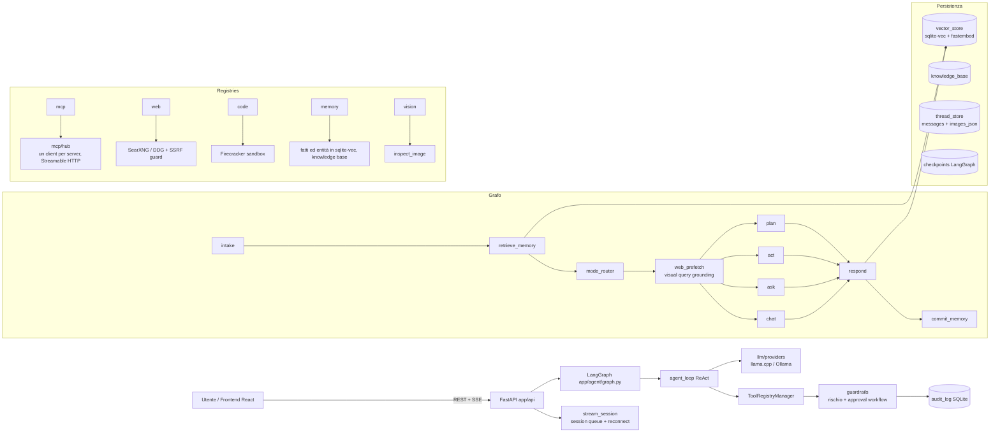
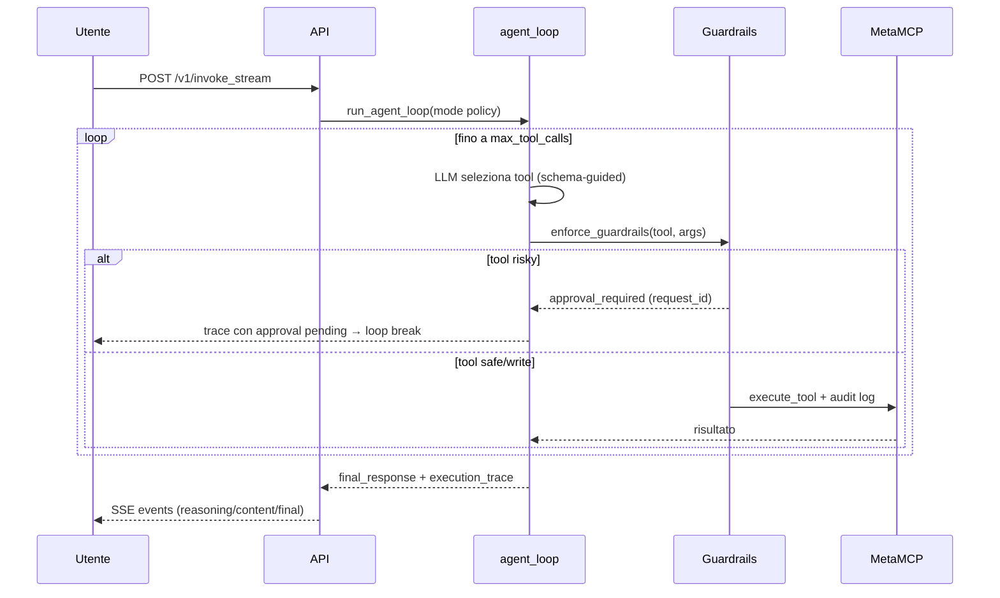

# Home Lab Agent - Backend

Backend LangGraph + FastAPI per l'agente AI del mio homelab.

## Architettura



### Flusso di una richiesta



## Struttura

Tutto il codice applicativo sta nel pacchetto `app/` (import assoluti `app.*`). Avvio API: `python -m app`; CLI: `python -m app.cli "task" --thread alice`.

| Pacchetto | Contenuto |
| :--- | :--- |
| `app/startup.py` | Avvio unico: fail-fast di sicurezza, schemi di tutti i database (`init_databases`), registry dei tool, scheduler. Lo usano il lifespan FastAPI, la CLI e i test |
| `app/api/` | `main.py` (app FastAPI, lifespan, middleware), `deps.py` (API key, rate limit), `agent_runner.py` (esecuzione del grafo sincrona e in streaming), `schemas.py`, `routes/` con un router per dominio: `chat`, `threads`, `approvals` (approvazioni e permessi), `memory`, `kb`, `providers`, `uploads`, `system` (health, status, audit) |
| `app/agent/` | `graph.py` (costruzione del grafo LangGraph e checkpointer), `nodes/` (un modulo per nodo: `intake`, `retrieve_memory`, `routing`, `web_prefetch`, `chat`, `ask`, `act`, `plan`, `respond`, `commit_memory`), `state.py` (`AgentState`), `llm_calls.py` (chiamate LLM in streaming e output strutturato), `execution_log.py` (esecuzione dei piani come Saga: log write-ahead e rollback), `agent_loop.py` (loop ReAct `AgentLoop`: una fase per metodo, cache e chiamate parallele read-only), `agent_prompts.py`, `mode_router.py` e `mode_policy.py` (scelta e budget della modalità), `tool_catalog.py`, `tool_schemas.py`, `stream_session.py` (sessioni SSE con pausa/ripresa/stop e riaggancio), `monitoring.py` (span e metriche) |
| `app/llm/` | `providers.py`: provider OpenAI-compatible (llama.cpp, LiteLLM) e Ollama |
| `app/observability/` | Metriche: `turns.py` (turni e chiamate LLM), `health.py` (campionamento dei servizi), `store.py` (`metrics.db`), `report.py` (aggregazioni per la dashboard) |
| `app/security/` | `policy.py` (rischio dei tool, analisi dei comandi shell, decisione: blocco deterministico o approvazione), `approvals.py` (richieste di approvazione, scope, approvazioni a runtime), `permissions.py` (permessi `thread`/`always`), `audit_log.py` |
| `app/memory/` | `vector_store.py` (sqlite-vec + fastembed), `facts.py` (fatti, entità e relazioni), `knowledge_base.py`, `letta_client.py` (messaggi e riassunti delle conversazioni), `thread_store.py` (cronologia, immagini, titoli), `transcript.py` (trascrizione JSONL dei thread, fallback se Letta non risponde) |
| `app/registry/` | Registry dei tool: `mcp`, `web`, `code` (sandbox Firecracker), `memory`, `vision`, `email`, `automations`, `calendar` |
| `app/automations/` | Definizioni, run, scheduler, `runner.py` (ciclo di vita della run), `steps/` (un gestore per tipo di step), `templating.py` (placeholder e dati tra step), `run_secrets.py`, `routes/` (endpoint REST per dominio: definizioni, run, approvazioni, artefatti, integrazioni, catalogo, webhook), code runner, template, loop; `db/` è il database SQLite con un modulo per aggregato (`definitions`, `runs`, `approvals`, `artifacts`, `breaker_states`, `integrations`) più `connection.py` e `schema.py` |
| `app/calendar/` | `db.py`, `router.py` (API), `sync.py` (import ICS/Google) |
| `app/mcp/` | `client.py`: client sincrono sull'SDK MCP ufficiale (Streamable HTTP), una sessione condivisa per processo con retry e reset (`get_mcp_client()`) |
| `app/integrations/` | Integrazioni di servizio per le automazioni |
| `app/core/` | `config.py` (istanza `settings` di Pydantic Settings, fail-fast sicurezza, `BACKEND_DIR`), `text_utils.py`, `image_utils.py` |
| `sdk/` | SDK pubblico per gli script delle automazioni (`@workflow`, `@step`, `AutomationContext`): resta fuori da `app/` perché lo importano gli script utente |

## Installazione

```bash
make venv   # dalla radice del repo: backend/.venv con Python 3.12 e requirements-dev.txt (richiede uv)
```

## Configurazione

`make setup` genera `backend/.env` in modo interattivo; in alternativa copia `.env.example` in `.env` e compila
i valori (riferimento completo in [.env.example](.env.example)).

Tutti i dati persistenti stanno in un'unica directory, `DATA_DIR`: in locale `data/` nella radice del repo
(ignorata da git), nei compose `/data` sul volume `agent_data`. I percorsi interni sono fissi e derivati
da `DATA_DIR` (`settings.checkpoint_db_path`, `settings.memory_dir`, …):

| Percorso | Contenuto |
| :--- | :--- |
| `checkpoints.db` | Checkpoint LangGraph, thread e messaggi, audit, permessi, memoria vettoriale (sqlite-vec), entità dei fatti |
| `automations.db` | Automazioni, run, approvazioni, artefatti, circuit breaker, integrazioni |
| `calendar.db` | Calendari ed eventi |
| `mcp.db` | Server MCP registrati dalla UI e impostazioni per tool |
| `metrics.db` | Metriche: turni, chiamate LLM, campioni di salute dei servizi (conservati `METRICS_RETENTION_DAYS` giorni) |
| `memory/` | Trascrizioni JSONL e riassunti per thread, log di monitoring |
| `artifacts/`, `uploads/`, `knowledge_base/` | Artefatti delle automazioni, immagini caricate, documenti della knowledge base |

## Avvio

### CLI
```bash
.venv/bin/python -m app.cli "task" --thread alice
```

### API REST
```bash
.venv/bin/python -m app
```

## Test

I test stanno in `tests/` (configurazione in `pytest.ini`). Due categorie:

- **Ermetici** (default): nessun servizio esterno. `tests/conftest.py` reindirizza tutti i dati in una
  directory temporanea e blocca le connessioni verso host non locali, quindi un servizio reale non mockato
  fa fallire il test subito. Timeout di 60 s per test.
- **`live`**: verificano il comportamento contro LLM, MetaMCP o Firecracker reali. Esclusi di default.

```bash
make venv                              # venv Python 3.12 con requirements-dev.txt
make test                              # suite ermetica
make test ARGS="-m live"               # solo test live (richiede la LAN homelab)
make test ARGS="tests/test_router_and_prefetch.py -q"

# Su CT 125: container di test isolato (nessun volume di produzione)
docker compose -f docker-compose.prod.yml run --rm --build backend-test
docker compose -f docker-compose.prod.yml run --rm backend-test -m live

# Lint
make lint
```

## Docker Compose (dev)

```bash
cd homelab-agent
docker compose -f docker-compose.dev.yml up --build
# Backend: http://localhost:8090/v1 — Frontend: http://localhost:5173
```

## Deploy con Docker (produzione)

Lo stack prod usa `docker-compose.prod.yml`: backend FastAPI + frontend compilato e servito da nginx (con proxy `/v1/` e SSE senza buffering).

```bash
# 1. Clona il repo e configura l'ambiente
cd homelab-agent
cp backend/.env.example backend/.env
# modifica backend/.env con i tuoi valori (API_SECRET_KEY, CORS_ORIGINS, URL servizi...)

# 2. Build e avvio
docker compose -f docker-compose.prod.yml up -d --build

# 3. Verifica
curl http://localhost:8090/v1/health          # {"status":"ok"}
curl http://localhost/                        # frontend UI
```

Il frontend nginx espone la porta 80 e inoltra `/v1/` al backend (nome servizio compose `backend`, porta interna 8090). Per HTTPS metti un reverse proxy davanti (es. Nginx Proxy Manager) puntando alla porta 80 del container frontend.

**Importante**: se accedi all'UI tramite un dominio proxato, aggiungi quell'origine (con schema) a `CORS_ORIGINS` nel `backend/.env`, altrimenti il browser bloccherà le chiamate API con "Disallowed CORS origin".

## Endpoint principali

| Metodo | Path | Descrizione |
|---|---|---|
| GET | `/v1/health` | Health check (pubblico) |
| GET | `/v1/status` | Health aggregato llama.cpp/MetaMCP/Letta |
| POST | `/v1/chat\|ask\|act\|plan\|invoke` | Chat sincrona per mode |
| POST | `/v1/invoke_stream` | Chat streaming SSE con supporto immagini |
| GET | `/v1/threads/{id}/stream` | Aggancio streaming live per riconnessione/multi-device |
| POST | `/v1/threads/{id}/control` | Controlli di flusso (pause, resume, stop) |
| POST | `/v1/images/upload` | Upload e validazione immagini multimodali |
| GET/DELETE | `/v1/threads[/{id}]` | Gestione thread e cronologia |
| GET | `/v1/audit` | Audit log tool call |
| GET | `/v1/approvals` | Approvazioni pending |
| POST | `/v1/approvals/{id}/approve\|deny` | Risolvi approvazione |
| GET/POST | `/v1/kb/documents` | Lista/upload documenti KB |
| DELETE | `/v1/kb/documents/{filename}` | Elimina documento |
| GET | `/v1/kb/search` | Ricerca semantica KB |
| GET | `/v1/memory/stats` | Fatti, entità, thread e fatti mai analizzati per le entità |
| GET/POST/DELETE | `/v1/memory/facts` | Fatti (con `query` ricerca per significato; filtri `thread_id`, `entity_id`), aggiunta, svuotamento |
| PUT/DELETE | `/v1/memory/facts/{id}` | Modifica (testo ed entità) ed eliminazione di un fatto |
| GET | `/v1/memory/entities[/{id}]` | Entità con numero di fatti; il dettaglio include le entità in relazione |
| PUT/DELETE | `/v1/memory/entities/{id}` | Rinomina, cambio di tipo, eliminazione (i fatti restano) |
| POST | `/v1/memory/entities/{id}/merge` | Unisce l'entità in un'altra |
| POST | `/v1/memory/entities/extract` | Assegna con l'LLM le entità ai fatti mai analizzati |
| GET/POST/PUT/DELETE | `/v1/mcp/servers[/{id}]` | Server MCP registrati (il predefinito MetaMCP viene dal `.env`) |
| POST | `/v1/mcp/servers[/{id}]/test` | Prova di connessione, anche prima di salvare |
| GET/PUT | `/v1/mcp/tools[/{name}]` | Tool MCP con impostazioni: attivo e rischio (`auto`, `view`, `confirm`, `blocked`) |
| POST | `/v1/mcp/reload` | Ricarica i cataloghi di tutti i server |
| GET | `/v1/metrics/summary?hours=` | Riepilogo della finestra: turni (esito, p50/p95), token e velocità per modello, tool più lenti, uptime dei servizi |
| GET | `/v1/metrics/timeseries?hours=&buckets=` | Le stesse metriche in intervalli uguali, più la disponibilità di ogni servizio per intervallo |
| GET | `/v1/metrics/turns?limit=&source=` | Ultimi turni registrati (`chat` o `automation`) |

## Server MCP

- **Server**: MetaMCP (`METAMCP_URL`, `METAMCP_API_KEY`) è il server predefinito; altri server Streamable HTTP si registrano dalla UI (Impostazioni → Server MCP) e sono salvati in `data/mcp.db`, con il token cifrato (`app/security/secret_box.py`).
- **Nomi dei tool**: quelli di MetaMCP restano invariati (`proxmox-mcp__…`); quelli dei server aggiunti prendono il prefisso `<id>__`. L'id di un nuovo server non può coincidere con un prefisso già presente nel catalogo.
- **Hub** (`app/mcp/hub.py`): un client per server, catalogo aggregato in parallelo e in cache per 120 s, ricaricato subito a ogni modifica; le chiamate sono instradate per nome del tool. Un server non raggiungibile mantiene gli ultimi tool noti.
- **Impostazioni per tool**: un tool disattivato esce dal catalogo dell'agente. Il rischio `view`/`confirm` prevale sulla classificazione per nome; `blocked` rifiuta il tool in ogni modalità, `dangerous` compresa.

## Memoria a lungo termine

- **Fatti** (`app/memory/facts.py`): record `kind='fact'` di sqlite-vec, unica fonte (Letta conserva solo messaggi e riassunti delle conversazioni). Un fatto quasi identico a uno esistente (coseno ≥ 0,95) non viene riscritto: riceve solo le entità nuove.
- **Entità**: tabelle `memory_entities` (nome, chiave normalizzata, tipo: `person`, `organization`, `place`, `project`, `software`, `infrastructure`, `other`) e `memory_fact_entities`. Due entità sono in relazione quando compaiono negli stessi fatti. Un'entità senza fatti viene eliminata.
- **Estrazione** (`app/agent/fact_extraction.py`): a fine turno, non in incognito, una chiamata a output vincolato restituisce fino a 5 fatti durevoli con le loro entità. I fatti salvati prima delle entità si etichettano dall'explorer (`/v1/memory/entities/extract`, 10 fatti per chiamata); un fatto analizzato senza entità viene segnato (`entities_checked`) e non torna in coda.
- **Recall**: il tool `recall_memory` e il recall semantico di `retrieve_memory` cercano tra i fatti.

## Osservabilità

Modulo `app/observability/`, database `data/metrics.db`, vista **Metriche** nel frontend.

- **Turni** (`turns.py`): ogni turno di chat (`agent_runner`) e ogni esecuzione di una run (`AutomationRunner.execute_run`) è misurato da `observe_turn`: durata, esito (`ok`, `error`, `stopped`: stop dell'utente, approvazione in attesa, pausa o annullamento), modalità o id dell'automazione, chiamate LLM e token sommati dal contextvar del turno, chiamate ai tool e errori contati a fine turno dall'audit log.
- **Chiamate LLM**: `LLMProvider.chat` registra ogni chiamata (anche quelle fuori da un turno, come titoli e riassunti) con modello, token, token del prompt riusati dalla cache ed errori; con llama.cpp anche i tempi di prompt e generazione (`timings`), da cui le velocità: il prompt conta solo i token nuovi.
- **Salute dei servizi** (`health.py`): un thread interroga ogni `METRICS_SAMPLE_INTERVAL_S` secondi llama.cpp, Letta, SearXNG e ogni server MCP attivo, e una volta al giorno elimina le metriche più vecchie di `METRICS_RETENTION_DAYS`.
- **Aggregazioni** (`report.py`): calcolate a richiesta dalle righe grezze; registrare una metrica non fa mai fallire una richiesta.

## Sicurezza

- `API_SECRET_KEY`: se impostata, tutti gli endpoint (tranne health) richiedono header `X-API-Key`. Se manca, il backend **non parte** a meno di `ALLOW_INSECURE=1`.
- Guardrail: tool rischiosi (delete/rollback/exec_*) richiedono approvazione utente; comandi shell pericolosi sono sempre bloccati.
- CORS ristretto a `CORS_ORIGINS`; rate limiting su endpoint chat (`RATE_LIMIT`, default 30/min).

curl http://localhost:8090/v1/health
