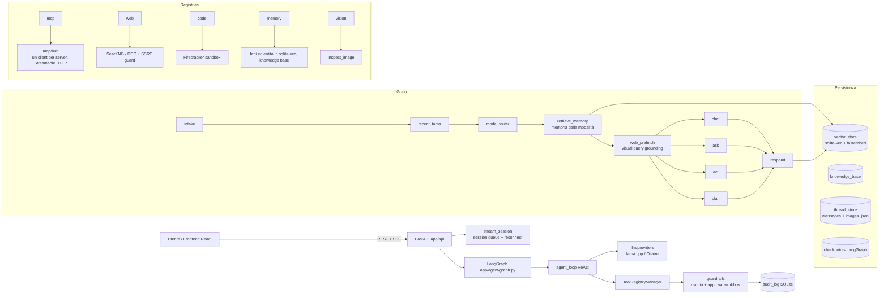
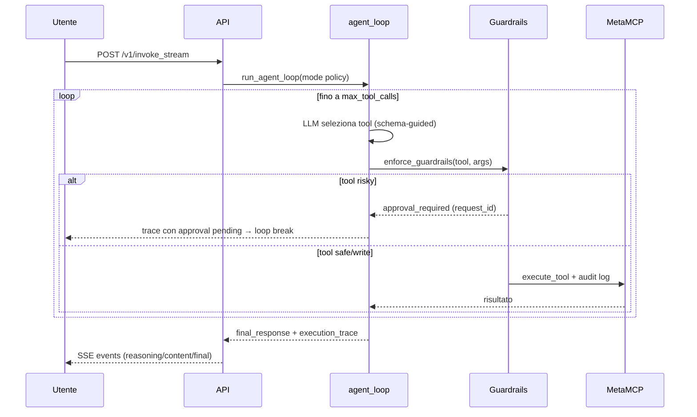

# Home Lab Agent - Backend

Backend LangGraph + FastAPI per l'agente AI del mio homelab.

## Architettura



### Flusso di una richiesta



## Struttura

Tutto il codice applicativo sta nel pacchetto `app/` (import assoluti `app.*`). Avvio API: `python -m app`; CLI: `python -m app.cli "task" --thread alice`.

| Pacchetto | Contenuto |
| :--- | :--- |
| `app/startup.py` | Avvio unico: fail-fast di sicurezza, schemi di tutti i database (`init_databases`), registry dei tool, scheduler. Lo usano il lifespan FastAPI, la CLI e i test |
| `app/api/` | `main.py` (app FastAPI, lifespan, middleware), `deps.py` (API key, rate limit), `agent_runner.py` (esecuzione del grafo sincrona e in streaming), `schemas.py`, `routes/` con un router per dominio: `chat`, `threads`, `approvals` (approvazioni e permessi), `memory`, `kb`, `providers`, `uploads`, `system` (health, status, audit) |
| `app/agent/` | `graph.py` (costruzione del grafo LangGraph e checkpointer), `nodes/` (un modulo per nodo: `intake`, `retrieve_memory` (con `recent_turns`), `routing`, `web_prefetch`, `chat`, `ask`, `act`, `plan`, `respond`), `state.py` (`AgentState`), `llm_calls.py` (chiamate LLM in streaming e output strutturato), `execution_log.py` (esecuzione dei piani come Saga: log write-ahead e rollback), `agent_loop.py` (loop ReAct `AgentLoop`: una fase per metodo, cache e chiamate parallele read-only), `agent_prompts.py`, `mode_router.py` e `mode_policy.py` (scelta e budget della modalità), `tool_catalog.py`, `tool_schemas.py`, `stream_session.py` (sessioni SSE con pausa/ripresa/stop e riaggancio) |
| `app/llm/` | `providers.py`: provider OpenAI-compatible (llama.cpp, LiteLLM) e Ollama; `reasoning.py`: profili di ragionamento e campionamento per modello |
| `app/observability/` | Metriche: `turns.py` (turni e chiamate LLM), `health.py` (campionamento dei servizi), `store.py` (`metrics.db`), `report.py` (aggregazioni per la dashboard) |
| `app/security/` | `policy.py` (rischio dei tool, analisi dei comandi shell, decisione: blocco deterministico o approvazione), `approvals.py` (richieste di approvazione, scope, approvazioni a runtime), `permissions.py` (permessi `thread`/`always`), `audit_log.py` |
| `app/memory/` | `vector_store.py` (sqlite-vec + fastembed), `facts.py` (fatti, entità e relazioni), `knowledge_base.py`, `thread_store.py` (cronologia, immagini, titoli, riassunti delle conversazioni) |
| `app/registry/` | Registry dei tool: `mcp`, `web`, `code` (sandbox Firecracker), `memory`, `vision`, `email`, `automations`, `calendar` |
| `app/automations/` | Definizioni, run, scheduler, `runner.py` (ciclo di vita della run), `steps/` (un gestore per tipo di step), `templating.py` (placeholder e dati tra step), `run_secrets.py`, `routes/` (endpoint REST per dominio: definizioni, run, approvazioni, artefatti, integrazioni, catalogo, webhook), code runner, template, loop; `db/` è il database SQLite con un modulo per aggregato (`definitions`, `runs`, `approvals`, `artifacts`, `breaker_states`, `integrations`) più `connection.py` e `schema.py` |
| `app/calendar/` | `db.py`, `router.py` (API), `sync.py` (import ICS/Google) |
| `app/mcp/` | `client.py`: client sincrono sull'SDK MCP ufficiale (Streamable HTTP), una sessione condivisa per processo con retry e reset (`get_mcp_client()`) |
| `app/integrations/` | Integrazioni di servizio per le automazioni |
| `app/core/` | `config.py` (istanza `settings` di Pydantic Settings, fail-fast sicurezza, `BACKEND_DIR`), `text_utils.py`, `image_utils.py` |
| `sdk/` | SDK pubblico per gli script delle automazioni (`@workflow`, `@step`, `AutomationContext`): resta fuori da `app/` perché lo importano gli script utente |

## Installazione

```bash
make venv   # dalla radice del repo: backend/.venv con Python 3.12 e requirements-dev.txt (richiede uv)
```

## Configurazione

`make setup` genera `backend/.env` in modo interattivo; in alternativa copia `.env.example` in `.env` e compila
i valori (riferimento completo in [.env.example](.env.example)).

Tutti i dati persistenti stanno in un'unica directory, `DATA_DIR`: in locale `data/` nella radice del repo
(ignorata da git), nei compose `/data` sul volume `agent_data`. I percorsi interni sono fissi e derivati
da `DATA_DIR` (`settings.checkpoint_db_path`, `settings.memory_dir`, …):

| Percorso | Contenuto |
| :--- | :--- |
| `checkpoints.db` | Checkpoint LangGraph, thread, messaggi e riassunti, audit, permessi, memoria vettoriale (sqlite-vec), entità dei fatti |
| `automations.db` | Automazioni, run, approvazioni, artefatti, circuit breaker, integrazioni |
| `calendar.db` | Calendari ed eventi |
| `mcp.db` | Server MCP registrati dalla UI e impostazioni per tool |
| `metrics.db` | Metriche: turni, chiamate LLM, campioni di salute dei servizi (conservati `METRICS_RETENTION_DAYS` giorni) |
| `artifacts/`, `uploads/`, `knowledge_base/` | Artefatti delle automazioni, immagini caricate, documenti della knowledge base |

## Avvio

### CLI
```bash
.venv/bin/python -m app.cli "task" --thread alice
```

### API REST
```bash
.venv/bin/python -m app
```

## Test

I test stanno in `tests/` (configurazione in `pytest.ini`). Due categorie:

- **Ermetici** (default): nessun servizio esterno. `tests/conftest.py` reindirizza tutti i dati in una
  directory temporanea e blocca le connessioni verso host non locali, quindi un servizio reale non mockato
  fa fallire il test subito. Timeout di 60 s per test.
- **`live`**: verificano infrastruttura reale (la microVM Firecracker). Esclusi di default. Il comportamento dei
  modelli non si verifica con test pass/fail ma con la valutazione qui sotto.

```bash
make venv                              # venv Python 3.12 con requirements-dev.txt
make test                              # suite ermetica
make test ARGS="-m live"               # solo test live (richiede la LAN homelab)
make test ARGS="tests/test_router_and_prefetch.py -q"

# Su CT 125: container di test isolato (nessun volume di produzione)
docker compose -f docker-compose.prod.yml run --rm --build backend-test
docker compose -f docker-compose.prod.yml run --rm backend-test -m live

# Lint
make lint
```

## Valutazione dei modelli

`app/evals/` misura quanto bene un modello guida l'agente, senza effetti collaterali: nessun tool eseguito, nessun
fatto salvato nella memoria reale. Sette suite, con i casi in `app/evals/cases/*.json`:

| Suite | Cosa chiama | Superato se |
| :--- | :--- | :--- |
| `routing` | `route_turn` | modalità (e, dove indicato, ricerca web) attese |
| `tools` | prima scelta dell'agent loop in `act` (`AgentLoop.first_selection`) | tool atteso (e argomenti indicati); nessun tool quando non serve; un tool assente dal catalogo salta il caso |
| `planning` | stesura del piano (`draft_plan`, livello `high`) e sua traduzione in `generate_plan_structure`, come in plan | piano valido, solo tool del catalogo, passi richiesti presenti, nessun tool vietato, non troppi passi |
| `rollback` | `generate_rollback_plan_with_llm` | compensazioni attese citate (nell'ordine, se richiesto) |
| `memory` | `propose_operations` del consolidamento su un solo scambio e memoria vuota | fatti con le entità attese; nessun fatto per chiacchiere, nozioni generali o cronaca della conversazione |
| `recall` | conversazioni datate salvate e consolidate come fa l'agente in un database temporaneo, poi `retrieve_memory` e una risposta strutturata alla domanda | valore atteso nella risposta (il dettaglio dice se era nel contesto); per le domande senza risposta in memoria, ammissione di non sapere. Casi: preferenze e dettagli tra thread, aggregazione su più thread, valori aggiornati, servizio dismesso, domande temporali, astensione, dettaglio iniziale di un thread lungo (riassunto) |
| `multistep` | agent loop completo in `act`, con i risultati dei tool simulati dal caso (`simulated_tools`: il registry non esegue nulla) su catene in cui un argomento dipende da un risultato precedente | chiamate attese nell'ordine (altre in mezzo ammesse), nessuna vietata, non troppe, valori dei risultati nella risposta. Misure per esecuzione: passi, chiamate, ripetizioni bloccate, argomenti non validi |

Ogni caso può girare più volte (`--repeat`) per misurare la stabilità. Il report di ogni modello (esito,
durata, chiamate e token per esecuzione) è un JSON in `data/evals/`; `compare` affianca, per ogni modello, il
risultato più recente di ogni suite in una tabella Markdown (un'esecuzione parziale aggiorna solo le sue suite). Le chiamate LLM delle valutazioni compaiono nelle metriche con `turn_key`
`eval:…`, ma non tra i turni. `--interleaved on|off` forza il pensiero tra i passi dell'agent loop per confrontare le
due forme dello stesso modello (il report porta la variante nel nome).

```bash
# Nel backend avviato su CT 125: i modelli vanno sempre indicati, e devono stare nella VRAM
make eval MODELS=LFM2.5-24B-A2B-HugeCtx
make eval MODELS=LFM2.5-24B-A2B-HugeCtx,Gemma-4-26B-Q3 ARGS="--suites routing,tools --repeat 3"
make eval-compare
```

## Docker Compose (dev)

```bash
cd homelab-agent
docker compose -f docker-compose.dev.yml up --build
# Backend: http://localhost:8090/v1 — Frontend: http://localhost:5173
```

## Deploy con Docker (produzione)

Lo stack prod usa `docker-compose.prod.yml`: backend FastAPI + frontend compilato e servito da nginx (con proxy `/v1/` e SSE senza buffering).

```bash
# 1. Clona il repo e configura l'ambiente
cd homelab-agent
cp backend/.env.example backend/.env
# modifica backend/.env con i tuoi valori (API_SECRET_KEY, CORS_ORIGINS, URL servizi...)

# 2. Build e avvio
docker compose -f docker-compose.prod.yml up -d --build

# 3. Verifica
curl http://localhost:8090/v1/health          # {"status":"ok"}
curl http://localhost/                        # frontend UI
```

Il frontend nginx espone la porta 80 e inoltra `/v1/` al backend (nome servizio compose `backend`, porta interna 8090). Per HTTPS metti un reverse proxy davanti (es. Nginx Proxy Manager) puntando alla porta 80 del container frontend.

**Importante**: se accedi all'UI tramite un dominio proxato, aggiungi quell'origine (con schema) a `CORS_ORIGINS` nel `backend/.env`, altrimenti il browser bloccherà le chiamate API con "Disallowed CORS origin".

## Endpoint principali

| Metodo | Path | Descrizione |
|---|---|---|
| GET | `/v1/health` | Health check (pubblico) |
| GET | `/v1/status` | Health aggregato llama.cpp/MetaMCP |
| POST | `/v1/chat\|ask\|act\|plan\|invoke` | Chat sincrona per mode |
| POST | `/v1/invoke_stream` | Chat streaming SSE con supporto immagini |
| GET | `/v1/threads/{id}/stream` | Aggancio streaming live per riconnessione/multi-device |
| POST | `/v1/threads/{id}/control` | Controlli di flusso (pause, resume, stop) |
| POST | `/v1/images/upload` | Upload e validazione immagini multimodali |
| GET/DELETE | `/v1/threads[/{id}]` | Gestione thread e cronologia |
| GET | `/v1/audit` | Audit log tool call |
| GET | `/v1/approvals` | Approvazioni pending |
| POST | `/v1/approvals/{id}/approve\|deny` | Risolvi approvazione |
| GET/POST | `/v1/kb/documents` | Lista/upload documenti KB |
| DELETE | `/v1/kb/documents/{filename}` | Elimina documento |
| GET | `/v1/kb/search` | Ricerca semantica KB |
| GET | `/v1/memory/stats` | Fatti, entità, thread e fatti mai analizzati per le entità |
| GET/POST/DELETE | `/v1/memory/facts` | Fatti (con `query` ricerca per significato; filtri `thread_id`, `entity_id`), aggiunta, svuotamento |
| PUT/DELETE | `/v1/memory/facts/{id}` | Modifica (testo ed entità) ed eliminazione di un fatto |
| GET | `/v1/memory/entities[/{id}]` | Entità con numero di fatti; il dettaglio include le entità in relazione |
| PUT/DELETE | `/v1/memory/entities/{id}` | Rinomina, cambio di tipo, eliminazione (i fatti restano) |
| POST | `/v1/memory/entities/{id}/merge` | Unisce l'entità in un'altra |
| POST | `/v1/memory/entities/extract` | Assegna con l'LLM le entità ai fatti mai analizzati |
| GET/POST/PUT/DELETE | `/v1/mcp/servers[/{id}]` | Server MCP registrati (il predefinito MetaMCP viene dal `.env`) |
| POST | `/v1/mcp/servers[/{id}]/test` | Prova di connessione, anche prima di salvare |
| GET/PUT | `/v1/mcp/tools[/{name}]` | Tool MCP con impostazioni: attivo e rischio (`auto`, `view`, `confirm`, `blocked`) |
| POST | `/v1/mcp/reload` | Ricarica i cataloghi di tutti i server |
| GET | `/v1/metrics/summary?hours=` | Riepilogo della finestra: turni (esito, p50/p95), token e velocità per modello, tool più lenti, uptime dei servizi |
| GET | `/v1/metrics/timeseries?hours=&buckets=` | Le stesse metriche in intervalli uguali, più la disponibilità di ogni servizio per intervallo |
| GET | `/v1/metrics/turns?limit=&source=` | Ultimi turni registrati (`chat` o `automation`) |

## Server MCP

- **Server**: MetaMCP (`METAMCP_URL`, `METAMCP_API_KEY`) è il server predefinito; altri server Streamable HTTP si registrano dalla UI (Impostazioni → Server MCP) e sono salvati in `data/mcp.db`, con il token cifrato (`app/security/secret_box.py`).
- **Nomi dei tool**: quelli di MetaMCP restano invariati (`proxmox-mcp__…`); quelli dei server aggiunti prendono il prefisso `<id>__`. L'id di un nuovo server non può coincidere con un prefisso già presente nel catalogo.
- **Hub** (`app/mcp/hub.py`): un client per server, catalogo aggregato in parallelo e in cache per 120 s, ricaricato subito a ogni modifica; le chiamate sono instradate per nome del tool. Un server non raggiungibile mantiene gli ultimi tool noti.
- **Impostazioni per tool**: un tool disattivato esce dal catalogo dell'agente. Il rischio `view`/`confirm` prevale sulla classificazione per nome; `blocked` rifiuta il tool in ogni modalità, `dangerous` compresa.

## Ragionamento

Ricerca alla base: [docs/reasoning/REASONING_RESEARCH.md](../docs/reasoning/REASONING_RESEARCH.md) e, per il pensiero tra i passi dell'agent loop, [docs/reasoning/INTERLEAVED_THINKING.md](../docs/reasoning/INTERLEAVED_THINKING.md).

- **Livelli per fase** (`ThinkingPolicy` in `mode_policy.py`): ogni fase del turno chiede un livello `off`, `low`, `medium` o `high`. Le chiamate di servizio (routing, memoria, titoli, piano strutturato, rollback) non ragionano.

  | | risposta e sintesi | scelta dei tool | stesura del piano |
  | :--- | :--- | :--- | :--- |
  | chat | off | — | — |
  | ask | low | low | — |
  | act | low | medium | — |
  | plan | low | medium | high |

- **Profilo del modello** (`app/llm/reasoning.py`, scelto con un pattern sull'alias del preset): dice se il modello ragiona sempre (LFM2.5), si accende e spegne (Qwen3.6, Qwen3.8, Gemma 4) o non ragiona (Phi-4), quale `reasoning_effort` del template usare per livello (Qwen3.8: `low`, `medium`, `xhigh`), il budget minimo dei modelli sempre ragionanti (256 token) e il campionamento raccomandato con e senza ragionamento. Un modello senza profilo riceve interruttore e budget e solo la temperatura del chiamante.
- **Budget**: `low` 512, `medium` 2048, `high` 8192 token, sempre inviati in modo esplicito (`reasoning_budget_tokens`, mai il default del preset) con una frase di transizione per i troncamenti; il budget si somma a `max_tokens`, che resta la lunghezza della risposta. Il budget scelto dall'utente nella chat (`reasoning_budget`) sostituisce quello dei livelli nelle fasi che ragionano (0 le spegne).
- **Pensiero tra i passi** (`interleaved` nel profilo, `AGENT_INTERLEAVED_THINKING=auto|on|off`): per Qwen3.6, Qwen3.8 e Qwen3 l'agent loop manda i passi come messaggi dopo il messaggio utente, cioè l'assistente con il suo pensiero (`reasoning_content`) e il JSON di selezione, poi un messaggio `tool` per risultato. Il template conserva il pensiero dei passi del turno e il prompt cresce solo in coda. Per gli altri modelli lo storico resta testo in coda al messaggio utente: Gemma 4 conserva il pensiero solo con `tool_calls` native, LFM2.5 con il pensiero conservato supera meno casi di `multistep`.
- **Piano**: la stesura (livello `high`) vede il catalogo dei tool, e il piano strutturato che viene eseguito la traduce invece di ripianificare da capo.
- **Campionamento**: con il ragionamento attivo vale quello del profilo (i modelli che ragionano degradano a temperature basse); senza, la temperatura del chiamante (bassa per gli output strutturati) o quella del profilo.

## Memoria

Tutta la memoria è nel backend, in `checkpoints.db`. Ricerca e proposta per le prossime evoluzioni: [docs/memory/MEMORY_RESEARCH.md](../docs/memory/MEMORY_RESEARCH.md).

- **Memoria per modalità** (`app/agent/nodes/retrieve_memory.py`): prima del router `recent_turns` legge solo gli ultimi 4 messaggi e la modalità dell'ultima risposta, senza chiamate al modello. Dopo il router `retrieve_memory` compone la memoria secondo la `MemoryPolicy` della modalità (`mode_policy.py`):

  | | chat | ask | act | plan |
  | :--- | :--- | :--- | :--- | :--- |
  | Riassunto e messaggi recenti | ~1500 token | ~6000 token | ~6000 token | ~6000 token |
  | Fatti di altri thread | no | fino a 5 | fino a 5, da verificare | fino a 5, da verificare |
  | Esecuzioni passate simili | no | no | fino a 3 | fino a 5 |
  | Piani modello approvati | no | no | fino a 2 | fino a 3 |

  L'ordine va dal più stabile al più variabile (profilo, riassunto, messaggi recenti, fatti, episodi; orario e richiesta dopo la memoria), così llama.cpp riusa da un turno all'altro la parte iniziale del prompt. I fatti portano la data.
- **Profilo** (`app/memory/profile.py`, `GET/PUT /v1/memory/profile`): testo scritto dall'utente nella vista Memoria (massimo 4000 caratteri), all'inizio della memoria di ogni turno in tutte le modalità. L'agente non lo modifica.
- **Conversazione**: la cronologia del thread viene da `thread_store` (testo della versione attiva, senza errori né il messaggio corrente). Oltre 20 messaggi non riassunti, o oltre 6000 token stimati, i più vecchi entrano nel riassunto del thread (`thread_summaries`, con il numero di messaggi coperti) e nella finestra ne restano 10.
- **Fatti** (`app/memory/facts.py`): record `kind='fact'` di sqlite-vec, unica fonte. Un fatto quasi identico a uno esistente (coseno ≥ 0,95) non viene riscritto: riceve solo le entità nuove. Validità temporale: un fatto smentito non si cancella, riceve `invalid_at` e `superseded_by` ed esce dalle ricerche; la vista Memoria mostra i superati a richiesta e li può rendere di nuovo validi (`POST /v1/memory/facts/{id}/restore`).
- **Entità**: tabelle `memory_entities` (nome, chiave normalizzata, tipo: `person`, `organization`, `place`, `project`, `software`, `infrastructure`, `other`) e `memory_fact_entities`. Due entità sono in relazione quando compaiono negli stessi fatti. Un'entità senza fatti viene eliminata.
- **Consolidamento** (`app/agent/memory_consolidation.py`): i fatti non nascono più a fine turno. Ogni giorno all'ora `MEMORY_CONSOLIDATION_HOUR` (fuso del container, default 3; -1 = solo su richiesta) o con **Consolida ora** nella vista Memoria (`GET/POST /v1/memory/consolidation`), i messaggi non ancora consolidati di ogni thread passano al modello attivo a blocchi (16 messaggi, ~4000 token) in ordine cronologico tra tutti i thread, insieme ai fatti già salvati simili ai messaggi dell'utente. Il modello risponde con operazioni `add`, `update` (il vecchio fatto diventa superato dal nuovo, alla data del messaggio) e `invalidate`, e può superare solo i fatti che gli sono stati mostrati; i fatti nuovi prendono la data del messaggio da cui vengono. Il punto raggiunto in ogni thread è in `thread_consolidation` e avanza solo se il blocco riesce. Poi la deduplicazione confronta i fatti nuovi dall'ultimo giro con tutti gli altri (coseno ≥ 0,85) e chiede al modello quali ripetono o contraddicono un altro fatto.
- **Entità** (`app/agent/fact_extraction.py`): i fatti senza entità si etichettano dall'explorer (`/v1/memory/entities/extract`, 10 fatti per chiamata); un fatto analizzato senza entità viene segnato (`entities_checked`) e non torna in coda.
- **Ricerca ibrida** (`app/memory/hybrid_search.py`): indici FTS5 mantenuti da trigger su `vec_memory` (`memory_fts`) e sulla versione attiva dei messaggi senza errori (`message_fts`), creati e popolati all'avvio. Fatti ed episodi si cercano per significato (coseno sopra soglia) e per parole (BM25; parole lunghe per prefisso, indirizzi IP come frase), fusi con la Reciprocal Rank Fusion: un nome o un ID esatto recupera ciò che l'embedding non avvicina.
- **Recall**: il tool `recall_memory` e la memoria del turno cercano tra i fatti con la ricerca ibrida; il tool `search_conversations` (ask, act, plan) cerca per parole nei messaggi di tutte le conversazioni, con estratto, data e titolo del thread.
- **Episodi** (`app/memory/episodes.py`): a fine turno act o plan con tool eseguiti, un record `kind='episode'` ricavato senza modello dalla traccia (richiesta, tool con argomenti, errori, esito; esclusi i turni in attesa di approvazione). I più simili alla richiesta entrano nella memoria dei turni act e plan. Elenco, ricerca ed eliminazione: `GET/DELETE /v1/memory/episodes` e scheda **Episodi** della vista Memoria.
- **Procedure** (`app/memory/procedures.py`, `app/agent/procedure_distillation.py`): memoria procedurale in due tipi, note su un tool (`tool_note`, aggiunte sotto il tool nel catalogo di act e plan come `NOTA APPROVATA`) e piani modello (`plan_template`, nella memoria di act e plan quando la richiesta è simile, con la ricerca ibrida). Entrano in uso solo dopo l'approvazione dell'utente nella scheda **Procedure** della vista Memoria. Le proposte arrivano dal tool `propose_procedure` (quando l'utente chiede all'agente di ricordare come si fa qualcosa) e dalle esecuzioni istruttive: un errore poi superato o una modifica riuscita in più passi, distillati con una chiamata a output vincolato. Le rifiutate restano come `rejected`, così la stessa proposta non torna; quelle scritte dall'utente nascono approvate. API: `/v1/memory/procedures` (elenco, creazione, modifica, `approve`, `reject`, eliminazione) e `/v1/memory/procedures/tools`.

## Osservabilità

Modulo `app/observability/`, database `data/metrics.db`, vista **Metriche** nel frontend.

- **Turni** (`turns.py`): ogni turno di chat (`agent_runner`) e ogni esecuzione di una run (`AutomationRunner.execute_run`) è misurato da `observe_turn`: durata, esito (`ok`, `error`, `stopped`: stop dell'utente, approvazione in attesa, pausa o annullamento), modalità o id dell'automazione, chiamate LLM e token sommati dal contextvar del turno, chiamate ai tool e errori contati a fine turno dall'audit log.
- **Chiamate LLM**: `LLMProvider.chat` registra ogni chiamata (anche quelle fuori da un turno, come titoli e riassunti) con modello, token, token del prompt riusati dalla cache ed errori; con llama.cpp anche i tempi di prompt e generazione (`timings`), da cui le velocità: il prompt conta solo i token nuovi.
- **Salute dei servizi** (`health.py`): un thread interroga ogni `METRICS_SAMPLE_INTERVAL_S` secondi llama.cpp, SearXNG e ogni server MCP attivo, e una volta al giorno elimina le metriche più vecchie di `METRICS_RETENTION_DAYS`.
- **Aggregazioni** (`report.py`): calcolate a richiesta dalle righe grezze; registrare una metrica non fa mai fallire una richiesta.

## Sicurezza

- `API_SECRET_KEY`: se impostata, tutti gli endpoint (tranne health) richiedono header `X-API-Key`. Se manca, il backend **non parte** a meno di `ALLOW_INSECURE=1`.
- Guardrail: tool rischiosi (delete/rollback/exec_*) richiedono approvazione utente; comandi shell pericolosi sono sempre bloccati.
- CORS ristretto a `CORS_ORIGINS`; rate limiting su endpoint chat (`RATE_LIMIT`, default 30/min).

curl http://localhost:8090/v1/health
